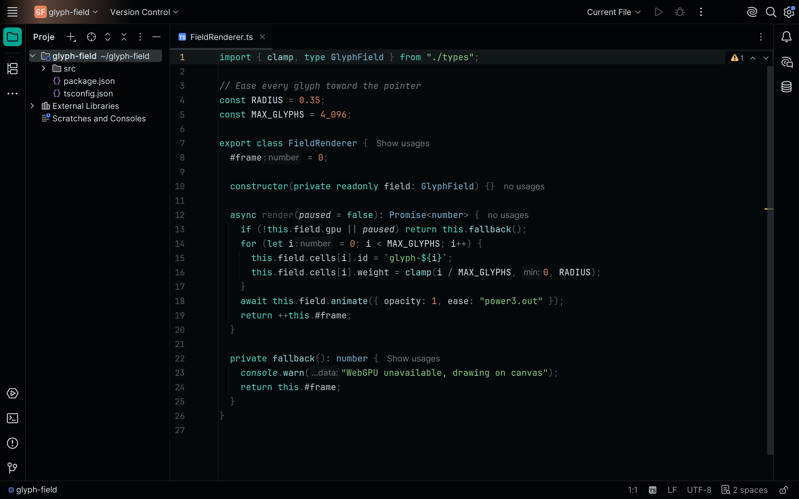
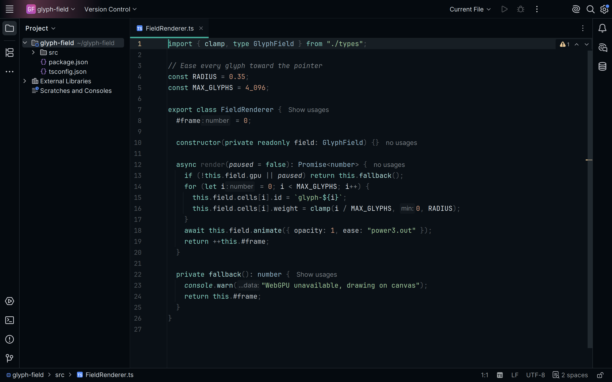
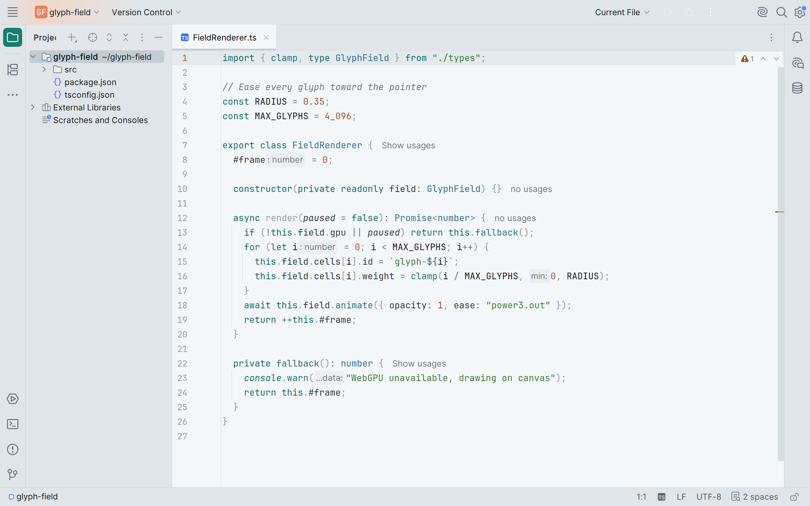
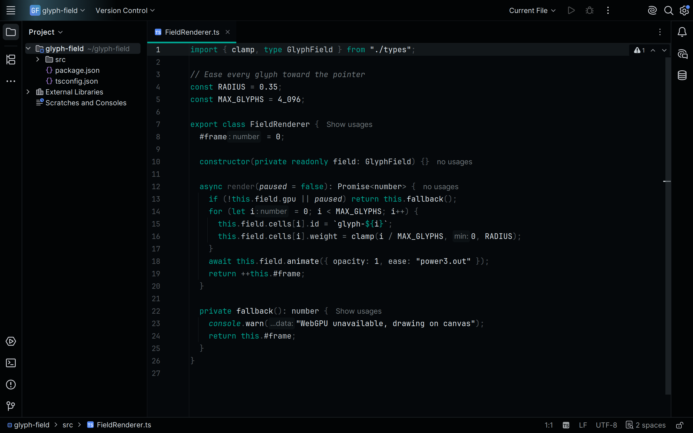

<!-- living-code-readme:1 -->
# 🧠 Living Code for JetBrains IDEs

**Calm slate. Living color.** Living Code for JetBrains IDEs. Repository-owned theme files, installation instructions and four color flavors.

[Installation](#installation) · [Flavors](#flavors) · [Configuration](#configuration) · [All ports](https://github.com/living-code-theme)

## Previews

<table data-lc-flavors>
<tr>
<td width="50%" valign="top">
<strong>Night</strong> Dark · full palette  

</td>
<td width="50%" valign="top">
<strong>Frost</strong> Dark · softer chroma  

</td>
</tr>
<tr>
<td width="50%" valign="top">
<strong>Paper</strong> Light · near-white slate  

</td>
<td width="50%" valign="top">
<strong>Signal</strong> Dark · teal accent  

</td>
</tr>
</table>

Select any preview to view the image at full size.

## Installation

One plugin, four themes, for IntelliJ IDEA, PyCharm, WebStorm, GoLand, Rider, CLion, RubyMine, PhpStorm, DataGrip and Android Studio (2024.1 or newer).

In the IDE open *Settings | Plugins | Marketplace*, search for **Living Code** and click **Install**, then pick **Living Code Night** (or Frost, Paper, Signal) in *Settings | Appearance & Behavior | Appearance | Theme*; the matching editor color scheme is applied with it.

**Without a marketplace:** download `living-code-jetbrains-0.1.1.zip` from the [latest GitHub release](https://github.com/living-code-theme/jetbrains/releases/latest) (or build it with `pnpm run package:jetbrains` from a checkout, which writes it to `dist/`). In *Settings | Plugins*, click the gear icon, choose *Install Plugin from Disk...*, pick the zip and restart.

The sources in the repository root are the plugin's layout: `META-INF/plugin.xml`, one `themes/living-code-<flavor>.theme.json` UI theme and one `themes/living-code-<flavor>.xml` editor scheme per flavor.

## Flavors

Expand a flavor for its full-size preview and activation instructions.

<strong>Night</strong> · Dark · full palette

Choose **Living Code Night** in *Settings → Appearance & Behavior → Appearance → Theme*. Its matching editor scheme is applied with it.

<strong>Frost</strong> · Dark · softer chroma

Choose **Living Code Frost** in *Settings → Appearance & Behavior → Appearance → Theme*. Its matching editor scheme is applied with it.

<strong>Paper</strong> · Light · near-white slate

Choose **Living Code Paper** in *Settings → Appearance & Behavior → Appearance → Theme*. Its matching editor scheme is applied with it.

<strong>Signal</strong> · Dark · teal accent

Choose **Living Code Signal** in *Settings → Appearance & Behavior → Appearance → Theme*. Its matching editor scheme is applied with it.

## Configuration

See [JetBrains IDEs's documentation](https://www.jetbrains.com/ides/) for application settings and reload behavior. The activation instructions above identify each supported flavor; keep your other application configuration.

## Compatibility

One plugin for JetBrains IDEs 2024.1 or newer, including IntelliJ IDEA, PyCharm, WebStorm, GoLand, Rider, CLion, RubyMine, PhpStorm, DataGrip and Android Studio. Plugin ID: `dev.livingcode.theme`, vendor **Living Code**. All four theme-provider IDs are unchanged.

## Contributing

Found a problem? [Open an issue](https://github.com/living-code-theme/jetbrains/issues/new/choose) with the app version, the flavor and a screenshot. Want Living Code somewhere else? [Request a port](https://github.com/living-code-theme/core/issues/new?template=port-request.yml).

Pull requests are welcome. Keep this README, `port.json` and `images/` in sync, and use real screenshots of the app, never mockups.

🦎 **One chameleon, many habitats.** Part of [Living Code](https://github.com/living-code-theme).

## License

[MIT](LICENSE) © Elliot Luque
